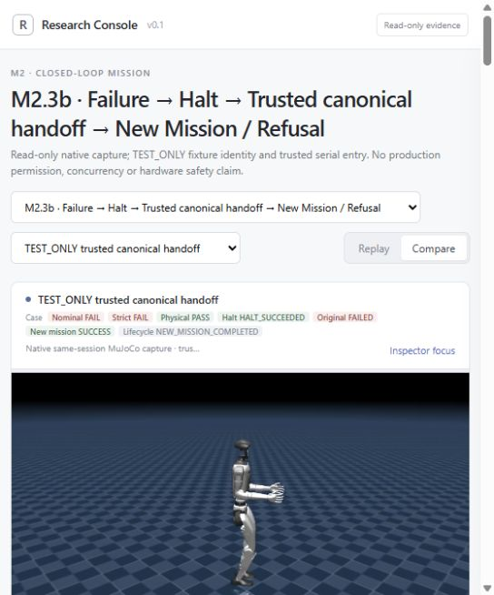
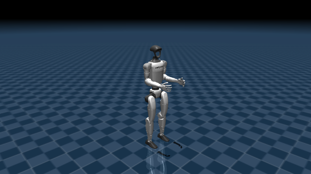
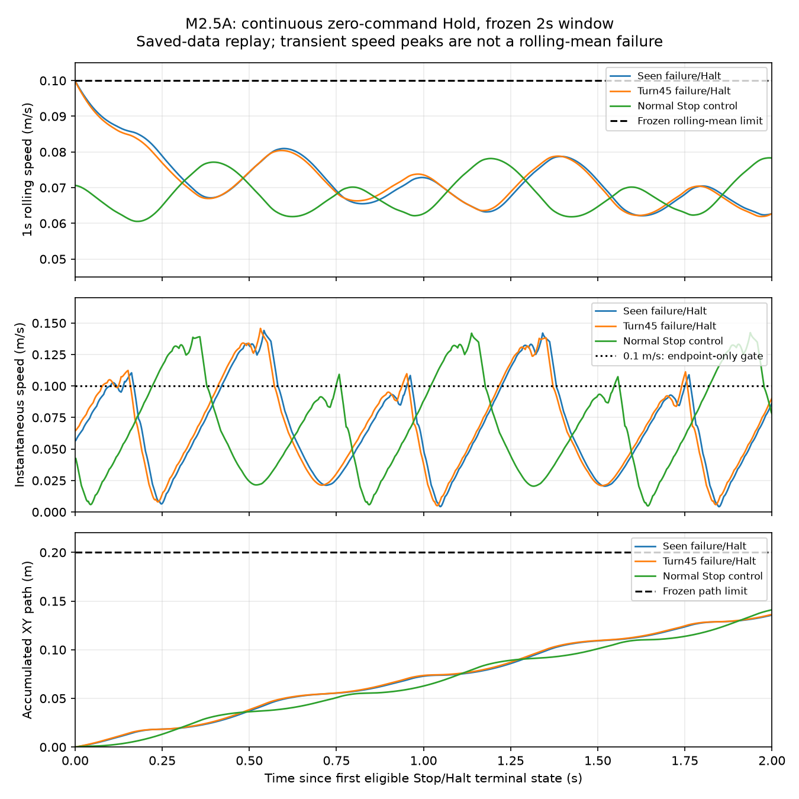
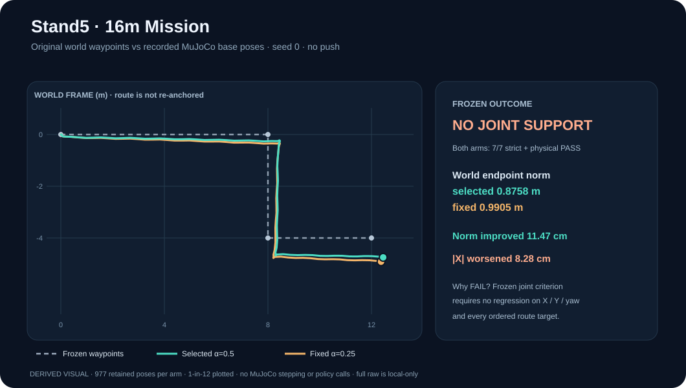

# G1 Evidence Gallery

**One Mission. Adaptive Execution. Verifiable Evidence.**

This is the **publicly inspectable visual index** for [G1 Jev Swarm Lab](../README.md). A working robot clip is interesting; the evidence explaining what actually passed or failed is the research.

> **Media provenance:** These are **MuJoCo simulation/state-playback visualizations**, not footage of a physical Unitree G1, and not substitutes for raw scientific records. Re-rendering retained poses does not constitute a new policy evaluation. All original strict/physical outcomes and negative results remain authoritative.

## 01 · Failure → Halt → authorized *new* Mission (M2.3b)

**Watch:** [trusted authorized handoff (MP4)](../experiments/research_console/m23b_trusted_handoff_001/runs/trusted_authorized/rollout.mp4) · [invalid/unauthorized control (MP4)](../experiments/research_console/m23b_trusted_handoff_001/runs/halt_only_invalid/rollout.mp4)

**Scientific outcome:** bounded TEST_ONLY handoff from a failed parent task to a **different** authorized Walk4 → Turn45 → Stop mission; the original mission remains **FAILED**. This is *not* recovery of the original goal or production-grade human authority.

**Evidence:** [qualification report](../experiments/m2/trusted_handoff_qualification_001/report.md) · [media/source hash manifest](../experiments/research_console/m23b_trusted_handoff_001/manifest.json).

## 02 · Strict failure and separately requested physical Halt (M2.1)

**Watch:** [failure with opt-in Halt (MP4)](../experiments/research_console/m2_post_failure_halt_001/runs/failure_opt_in/rollout.mp4) · [control run (MP4)](../experiments/research_console/m2_post_failure_halt_001/runs/safe_opt_in/rollout.mp4)

**Scientific outcome:** the task violation is preserved; a distinct opt-in StopSkill reduced measured motion in one frozen simulation state. This is not proof of a general emergency stop, hardware safety, or original-task completion.

**Evidence:** [M2.1 physical-halt report](../experiments/m2/post_failure_halt_integration_001/report.md).

## 03 · Better global route, **strict FAIL** (Phase 3A visual replay)

**Watch:** [original reference, α=0 (MP4)](../experiments/research_console/vertical_slice_001/runs/alpha0-off/rollout.mp4) · [corrected reference, α=0.5 (MP4)](../experiments/research_console/vertical_slice_001/runs/alpha05-off/rollout.mp4)

**Scientific outcome:** in the retained 16 m seen case, the α=0.5 arm improves global endpoint error (1.841 m → 1.209 m), but the first Walk local lateral error rises to 0.372 m and violates its frozen strict limit. **Strict outcome: FAIL.** A visually smoother route must not be relabeled successful.

**Media method:** official G1 meshes rendered from retained/captured poses at 20 fps. The render processes use `mj_forward` to display saved states, with no new `mj_step`. These are **derived visual replays**, not original camera recordings.

**Evidence:** [renderer, parity, scoring and source-bound Inspector report](../experiments/research_console/vertical_slice_001/REPORT.md). It documents the separate pose-capture qualification and important scientific limitations.

## 04 · Bounded post-Halt Hold (M2.5A)

**Scientific outcome:** bounded, previously seen seed-0 post-Halt Hold qualification, plus normal-Stop control. The plot is a derived research figure, not video proof of long-duration stationarity or safety across unseen states.

**Evidence:** [M2.5A report](../experiments/m2/post_halt_hold_qualification_001/report.md).

---

## Recent results awaiting evidence publication

The following were analyzed and sealed **locally** on 2026-10-13; this GitHub documentation change does **not** pretend their full raw bundles or fresh rendered G1 clips are already online.

### Stand5 · actual recorded world paths (derived figure, not new physics)

[Open full route figure](evidence-media/stand5-world-route-20261013.svg) · [Exact pose / result hash provenance](evidence-media/stand5-world-route-20261013.provenance.json)

This figure projects the **977 stored MuJoCo qpos samples per arm** into the original mission world XY frame, plotting every 12th sample plus the endpoint. It does **not** generate, rerun, infer, or modify robot motion. The underlying complete pose archives are still locally sealed, **not publicly downloadable from this PR**. It illustrates the existing trade-off, not a new accepted result: endpoint norm improves 11.47 cm, but final absolute X error worsens 8.28 cm, so **`NO_JOINT_SUPPORT` remains unchanged**.

| Study | Retained conclusion | Public-evidence status |
| --- | --- | --- |
| T2a: frozen B0 / C0 / C256 seen-case PPO comparison | **`NO_MEANINGFUL_GAIN`**; all three physical/task/strict gates pass, but no added gate-level learning gain | Local evidence archive; not accepted-main/public visual publication. [Draft PR #33](https://github.com/Anhao1314/g1-jev-swarm-lab/pull/33) is *engineering readiness*, not an experiment result. |
| Stand5 16 m: state-selected α=0.5 vs fixed α=0.25 | **`NO_JOINT_SUPPORT`**: endpoint norm improves ~11.47 cm but final absolute X error worsens ~8.28 cm under the predeclared joint rule | Locally sealed original pose, trace and comparison receipts; **no newly published G1 clip or full public raw bundle here**. |
| Walk → Turn skill-handoff investigation | **Research hypothesis only**: both historical arms exit Walk near 0.493 m/s and move ~0.38 m along entry heading during the following Turn | Read-only local analysis; **no new physical intervention**. |

No scientific-selection pointer, historical label, qualification, or accepted-main status is changed by this index. These rows must be updated with **direct public artifacts and their SHA256/protocol identity before being advertised as publicly reproduced research**.

## Minimum contract for a new visual research release

1. **What was tested:** mission, scenario, seed, control arm, original baseline, frozen thresholds and verdict (including FAIL / INCONCLUSIVE).
2. **What is recorded:** exact execution commit, original protocol/asset hashes, raw evidence manifest and receipt, sample/pose coordinates, and failure/cleanup status.
3. **What the clip actually is:** original simulation capture, deterministic state playback, or a derived chart. State playback must not be called new physics or real-world camera footage.
4. **How to inspect it:** link a short preview and a source-bound report/raw locator. Use the existing tracked MP4s rather than duplicating them.
5. **What cannot be concluded:** no generalization, production safety, untested recovery, or algorithmic gain from aesthetics alone.

**Publish the evidence before polishing the narrative.** The independent evidence should explain the animation, not the other way around.

Related: [Historical visual research summary](lab-notebook/visual-summary.md) · [Research lab notebook](lab-notebook/README.md) · [Repository home](../README.md).
